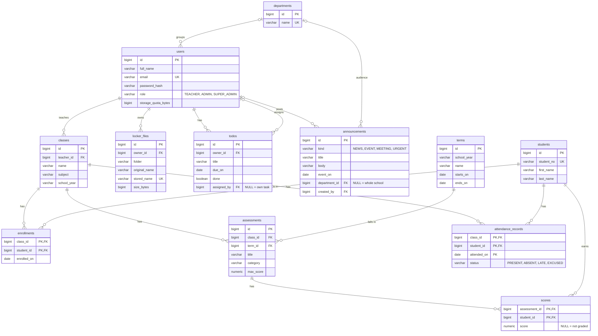

# iGradEd database

All data lives in one relational database. The schema is defined by numbered SQL files in
`src/main/resources/db/migration/`, applied automatically at startup by [Flyway](https://flywaydb.org).
Hibernate (JPA) only reads and writes rows; it never changes the tables.

| File | Contains |
| --- | --- |
| `V1__users.sql` | `users` (accounts, roles, Locker quota) |
| `V2__classes_and_students.sql` | `terms`, `classes`, `students`, `enrollments` |
| `V3__grades_and_attendance.sql` | `assessments`, `scores`, `attendance_records` |
| `V4__locker_todos_announcements.sql` | `locker_files`, `todos`, `announcements` |
| `V5__departments_tasks_announcements.sql` | `departments`; `users.department_id`; `todos.assigned_by`; `announcements.department_id`, `event_on`, MEETING kind |

## Diagram



## Rules built into the database

- Deleting a **department** unassigns its people (`users.department_id` becomes NULL) and deletes its announcements.
- Deleting the admin who gave a task keeps the task (`assigned_by` becomes NULL).

- Emails are unique. Roles, score limits, attendance statuses, announcement kinds and file sizes are checked,
  so bad data is rejected even if the app has a bug.
- Deleting a **teacher** deletes their classes, assessments, scores, attendance, Locker file records and to-dos.
  **Students** stay, because they can be in other teachers' classes.
- Deleting a student removes their enrollments, scores and attendance.
- A **term** with assessments in it can't be deleted.
- Deleting the admin who posted an announcement keeps the announcement (author becomes empty).
- Each student can be in a class once, have one score per assessment and one attendance record per class per day.

## Locker files

The database only stores each file's details (`locker_files`). The file itself is saved on disk at
`./data/locker/<owner id>/<stored_name>`, where `stored_name` is a random UUID. Back up the database and
`data/locker/` together, or records and files will not match.

## Useful queries

Locker space used per teacher, against their limit:

```sql
SELECT u.email,
       COALESCE(SUM(f.size_bytes), 0) AS used_bytes,
       u.storage_quota_bytes          AS limit_bytes
FROM users u
LEFT JOIN locker_files f ON f.owner_id = u.id
GROUP BY u.id, u.email, u.storage_quota_bytes;
```

## Changing the schema

1. Never edit a migration that has already run. Flyway remembers a checksum for each one and will refuse to start.
2. Add a new file with the next number, for example `V5__add_class_room.sql`:
   ```sql
   ALTER TABLE classes ADD COLUMN room VARCHAR(40);
   ```
3. Restart the app. Flyway applies it.
4. Update the matching Java entity.

Keep the SQL plain (standard types, `GENERATED BY DEFAULT AS IDENTITY`) so it runs on both H2 and PostgreSQL.

## Local development database

The app uses an H2 file at `./data/igraded.mv.db`, which is git-ignored.
To start over, stop the app and delete the `data/` folder.

## Moving to PostgreSQL for real use

1. Add to `pom.xml`:
   ```xml
   <dependency>
       <groupId>org.postgresql</groupId>
       <artifactId>postgresql</artifactId>
       <scope>runtime</scope>
   </dependency>
   <dependency>
       <groupId>org.flywaydb</groupId>
       <artifactId>flyway-database-postgresql</artifactId>
   </dependency>
   ```
2. Create an empty database, then set these (as environment variables or a private `application-prod.properties`,
   never committed to GitHub):
   ```
   spring.datasource.url=jdbc:postgresql://localhost:5432/igraded
   spring.datasource.username=...
   spring.datasource.password=...
   ```
3. Start the app. Flyway builds all tables on the empty database.

The four migrations were tested on PostgreSQL 16.
